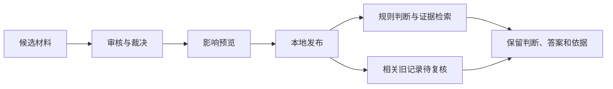

# Design Wiki · 设计规范活知识库

一个本地运行的设计规范知识库原型：保存规则的来源与适用条件，把候选入库、审核发布、检索问答和变更后复核连接起来。

**Python 3.10+ · 本地网页 · 可复用 Skill · 可选 DeepSeek API**

## 可以做什么

- **情境判断**：分别记录规则适用性、满足情况和缺失条件；未知例外不默认成“否”。
- **入库与维护**：候选正文与结构化字段 → 明确审核 → 影响预览 → 发布本地修订。
- **依赖追踪**：相关变更提示复核，新记录关联旧记录，保留当时条件与答案。
- **证据问答**：BM25、中英术语表和显式来源过滤，默认 Top-K=4；可以只检索，或明确调用模型生成答案。
- **Skill 复用**：在其他智能体中运行相同的检索、入库、发布与复核步骤。



## 快速开始

```sh
git clone https://github.com/ZoeXZY/design-wiki.git
cd design-wiki
python3 server.py
```

浏览器打开 **http://127.0.0.1:8765**。没有模型密钥也可以体验结构化判断、入库审核、发布和只检索证据。

| 入口 | 用途 |
| --- | --- |
| `/` | 规则、情境判断、维护复核与历史 |
| `/workflow.html` | 候选入库、审核、预览和发布 |
| `/qa.html` | 检索、可选真实问答和记录 |
| `/ingestion.html` | 5种维护风险及1个正常对照 |
| `/experience.html` | 复制少量问题到其他模型进行手工体验 |

端口占用时运行 `python3 server.py --port 8766`。使用新的状态文件可独立试演：

```sh
python3 server.py --state demo_rehearsal/workspace.json --port 8768
```

运行状态默认位于 `runtime/`，不修改 `data/` 种子。不要将运行状态和密钥提交到仓库。

## 可选：真实模型问答

在启动服务的终端环境中设置自己的 `DEEPSEEK_API_KEY`，然后启动服务。公开版只读取该环境变量，不访问其他应用的凭证。`.env.example` 仅是变量说明，程序不会自动加载 `.env`。

默认模型 `deepseek-flash`，thinking enabled，reasoning_effort max，max_tokens 8192（含推理 token），不设置 temperature。配置位于 `model_client.py`；供应商模型可用性以自己的账号为准。

点击生成或重新回答会使用自己的付费额度；每次保存证据、输入、实际参数、原始返回及用量。失败不自动重试。TLS 始终验证；如 Python 缺少证书，可安装 `requirements.txt` 中的 certifi。

原始答案保留不改写。引用编号检查只说明编号存在，不保证每个事实都被证据支持。

## 用 Skill

将完整 `skills/design-wiki` 文件夹交给支持 Skills 的智能体，或让模型阅读其中 `SKILL.md`。随包带独立运行核心，首次启动不继承其他项目的历史。

```sh
python3 skills/design-wiki/scripts/wiki.py serve --workspace ./skill-workspace --port 8786
```

另开终端，仅检索示例：

```sh
python3 skills/design-wiki/scripts/wiki.py --url http://127.0.0.1:8786 retrieve --question "Ant Design与GOV.UK对主按钮数量有什么建议？" --family "Ant Design" --family "GOV.UK"
```

完整命令见 [Skill 操作说明](skills/design-wiki/references/commands.md)。

## 数据、边界与验证

首批数据是15份公开资料的固定快照，运行时形成193个公共证据单元，另加入3条当前本地规则。版本、资料角色和来源随记录保留，公开资料不会自动联网更新。

目前只实现目标尺寸最低要求、目标尺寸增强要求、文字最低对比度三类结构化规则。正文与字段由使用者填写；尚不支持任意 Word/PDF 解析、自动测量网页、自动裁决语义冲突或通用合规认证。本地服务没有多用户身份和权限系统，应运行在默认回环地址。

```sh
python3 -B -m unittest discover -s tests -v
python3 -B skills/design-wiki/scripts/self_test.py
```

公开版包含40项原核心回归、3项环境变量凭证测试和4项Skill集成测试。模型接口在自动测试中使用明确替身，不消耗真实API额度。它们是开发回归，不是模型准确率或真实用户研究。

在课堂项目的更早阶段，24道相同问题分别经过三种检索配置，再加16个结构化案例，形成88条正式模型任务；实验暴露了日期记录被切断、跨来源证据不足等问题，推动了当前实现。完整私人运行记录未纳入公开仓库，公开版不宣称泛化收益已被证明。方法和限制见 [研究说明](docs/research.md)。

## 项目结构

```text
server.py / engine.py / workflow.py  本地服务、判断与维护
rag.py / model_client.py             检索与可选真实模型接口
static/                             本地网页
data/                               规则、构造案例、公开资料与许可
tests/                              开发回归
skills/design-wiki/                  可复用Skill及独立核心
docs/                               研究与使用边界
```

## 贡献与来源

建议先提交可复现案例，描述规则版本、给定条件、预期行为与实际结果。不要在 Issue、提交或测试文件中附上密钥及私人资料。更改核心后同步 Skill 内置副本，并执行两组测试。

本项目由 ZoeXZY 发起，使用 Codex 辅助整理方法、编写与调试代码；DeepSeek 是可选的问答后端。个人研究判断和实现边界见研究说明。

原始项目代码采用 [MIT License](LICENSE)。第三方规范资料仍遵循各自许可，详见 [THIRD_PARTY_NOTICES.md](THIRD_PARTY_NOTICES.md) 及 `data/licenses/`。本项目不代表任何规范发布机构。
